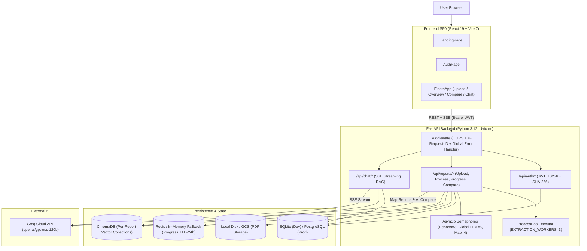
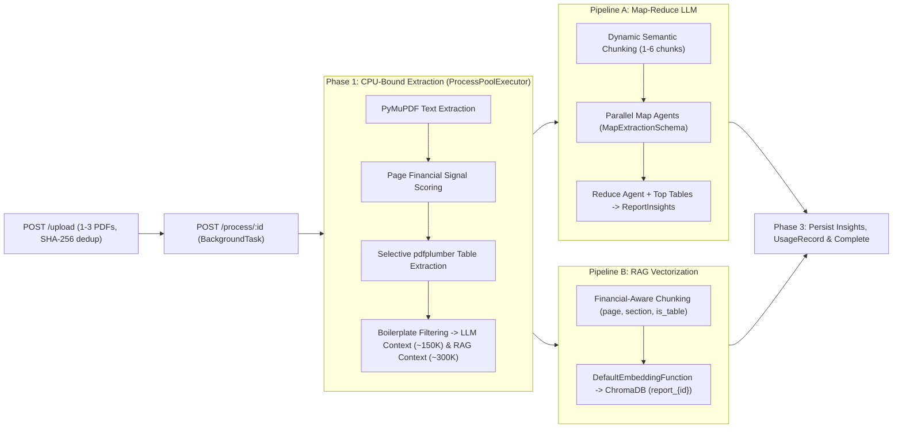
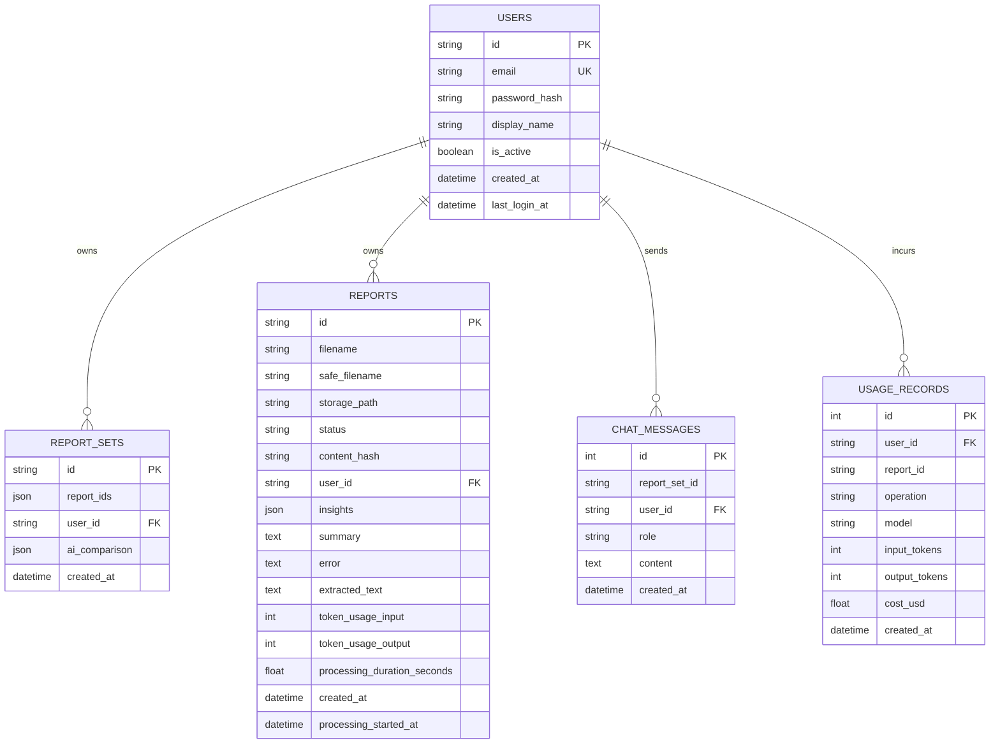
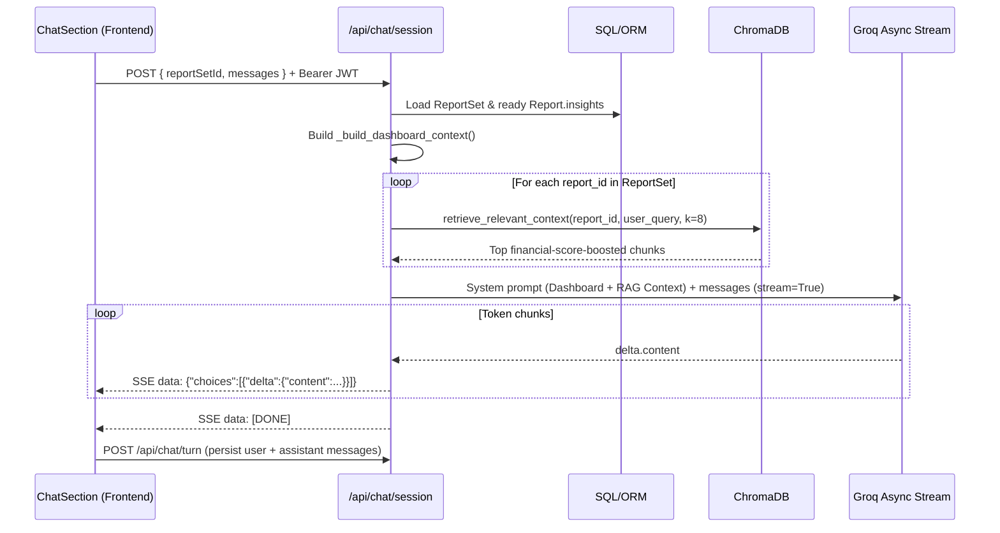
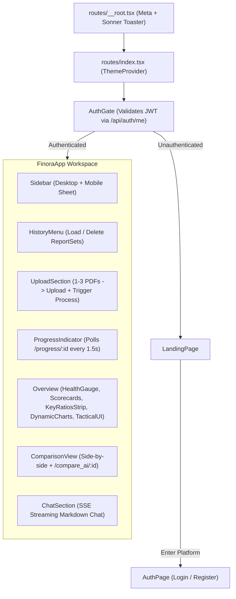

# Finora — System Architecture

This document describes the end-to-end architecture of **Finora**, an AI-powered financial intelligence platform for analyzing, comparing, and conversing with corporate annual reports.

---

## 1. High-Level System Architecture

Finora follows a decoupled **client–server architecture** with an async Python backend orchestrating CPU-bound PDF extraction, parallel LLM map-reduce pipelines, vector embeddings, and real-time progress tracking.

---

## 2. Backend Architecture (`Back/finora-backend-main`)

### 2.1 Application Entry & Middleware (`main.py`)
- **Lifespan Management:** Initializes upload directories, creates SQLAlchemy tables (`init_db()`), and boots/shuts down the `ProcessPoolExecutor` (`init_extraction_pool` / `shutdown_extraction_pool`).
- **CORS:** Permissive (`*`) in `development`; locked to `ALLOWED_ORIGINS` in `production`.
- **Request Tracing:** Every request receives an `X-Request-ID` header for correlated structured logging (`logger.py`).
- **Global Exception Handler:** Catches unhandled exceptions and returns a consistent `500` JSON payload with the `request_id`.

### 2.2 Routers
| Router | Prefix | Responsibilities |
|---|---|---|
| `routers/auth.py` | `/api/auth` | Pure-stdlib HS256 JWT creation/verification, salted SHA-256 password hashing, user registration/login, profile & token usage analytics |
| `routers/reports.py` | `/api/reports` | Multi-PDF upload (up to 3 files, 25 MB each), SHA-256 deduplication cache, async processing trigger, progress polling, history, multi-company comparison (`compare` & `compare_ai`), deletion + ChromaDB cleanup |
| `routers/chat.py` | `/api/chat` | SSE streaming chat backed by dashboard insights + ChromaDB RAG retrieval, chat turn persistence, history loading/clearing |

---

## 3. AI & PDF Processing Pipeline

When `POST /api/reports/process/{report_id}` is called, FastAPI returns immediately and schedules `_process_report_async` as a background task. Progress is tracked monotonically across 10 pipeline steps via `ProgressTracker` (`services/progress_tracker.py`).

### Key Pipeline Details
1. **Intelligent Financial Extraction (`services/financial_extractor.py`):**
   - Scores every page using `FINANCIAL_KEYWORDS`, currency/percentage density, and section markers (`STATEMENT_SECTION_MARKERS`).
   - Runs `pdfplumber` table extraction **only** on financially relevant candidate pages to keep 600-page PDFs under ~60s.
2. **Parallel Execution (`routers/reports.py`):**
   - **Pipeline A (Map-Reduce)** and **Pipeline B (Vectorization)** run concurrently via `asyncio.create_task`.
   - If Pipeline A fails, Pipeline B is cancelled. If Pipeline B fails, Pipeline A still completes gracefully (graceful degradation).
   - Malformed LLM JSON responses are recovered with `json_repair` and validated against Pydantic schemas (`ai_schema.py`).
3. **Monotonic Progress Tracking (`services/progress_tracker.py`):**
   - Uses Redis (`finora:progress:{report_id}`, 24h TTL) in production, falling back to an in-memory dict locally.
   - Guarantees `progress` and `completed_steps` never decrease; DB is the authoritative source of truth for terminal states (`ready` / `error`).

---

## 4. Database Schema (`database.py`)

Supports **SQLite** (with WAL mode enabled for concurrent reads) in local development and **PostgreSQL** (`pg8000`) on Cloud SQL in production.

---

## 5. RAG & Streaming Chat Architecture (`services/rag.py` & `routers/chat.py`)

- **Per-Report Vector Isolation:** Each report is stored in its own ChromaDB collection (`report_{report_id}`). Queries only touch collections belonging to the authenticated user's `ReportSet`.
- **Financial-Aware Chunking:** Splits along page boundaries (`--- PAGE`), section headers (`###`), and table boundaries (`--- TABLE`), attaching `page_num`, `section_type`, `is_table`, and `financial_score` metadata.

---

## 6. Frontend Architecture (`Front/finora-frontend-main`)

Built as a **React 19 + TypeScript** Single Page Application using **Vite 7**, **TanStack Router**, **Tailwind CSS v4**, and **shadcn/ui**.

### Key Frontend Patterns
- **Centralized API Client (`src/lib/api.ts`):** Wraps `fetch` with `authFetch` to inject `Authorization: Bearer <token>`, handle `401` session expiration, and stream SSE responses.
- **Type Parity (`src/lib/types.ts`):** Mirrors backend Pydantic schemas (`ReportInsights`, `ReportSet`, `AIComparisonData`).
- **Dev Proxy:** Vite proxies `/api/*` to `http://localhost:8000` in development; production bakes `VITE_API_BASE_URL` at build time.

---

## 7. Security, Isolation & Concurrency Controls

- **Authentication:** HS256 JWTs signed with `JWT_SECRET` (default 72h expiry); passwords hashed with per-user random salt + SHA-256.
- **Tenant Isolation:** Every `ReportSet`, `Report`, `ChatMessage`, and `UsageRecord` is scoped by `user_id`. ChromaDB collections are isolated per `report_id` and only queried after verifying `ReportSet` ownership.
- **File Safety:** Uploaded PDFs are validated for `application/pdf` MIME type, non-empty size, and `MAX_FILE_SIZE_MB` (25 MB), with filenames sanitized via `secure_filename()`.
- **Concurrency & Cost Protection:**
  - `_report_processing_sem` limits concurrent report pipelines (`3`).
  - `_global_llm_sem` caps global concurrent Groq API calls (`MAX_GLOBAL_LLM_CONCURRENCY=6`) to prevent rate-limit storms.
  - `MAX_TOKEN_BUDGET_PER_REPORT` (`500,000` tokens) aborts runaway extraction loops.

---

## 8. Deployment Topology

| Component | Local Development | Production (Google Cloud) |
|---|---|---|
| **Backend API** | `uvicorn main:app --reload` | Cloud Run (`Dockerfile`, non-root `appuser`, 1 worker, auto-scaling) |
| **Database** | SQLite (`finora.db`, WAL mode) | Cloud SQL (PostgreSQL via `pg8000`) |
| **Progress Store** | In-memory Python dict | Memorystore Redis (`REDIS_URL`) |
| **Vector Store** | Local ChromaDB `PersistentClient` (`./chroma_db`) | Dedicated `finora-chromadb` HTTP service (`CHROMA_HOST`) |
| **Frontend** | Vite dev server (`localhost:5173`) | Static `dist/` bundle on CDN / Vercel / Netlify / Nginx |
